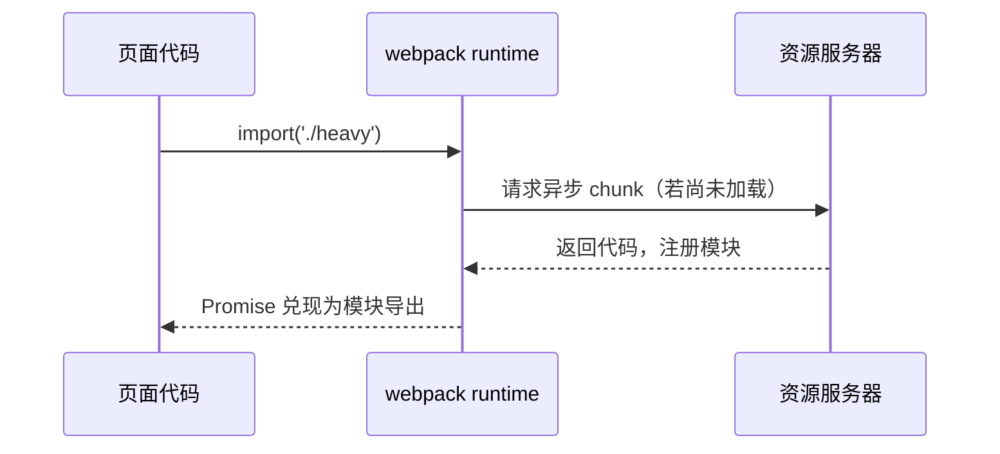
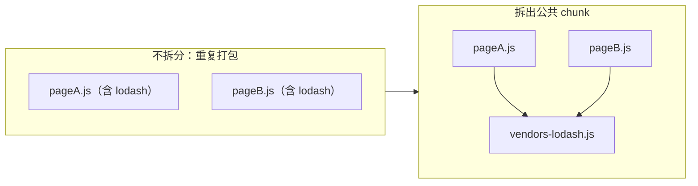
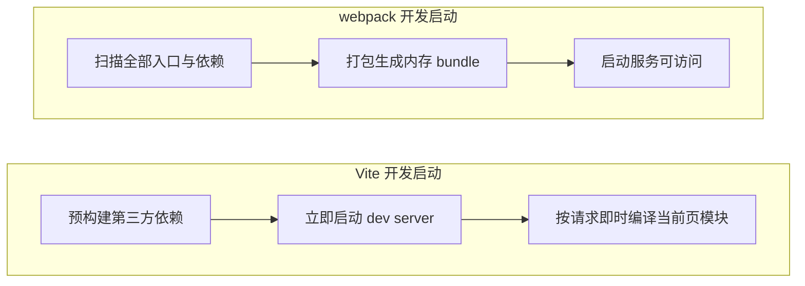

每天执行 `npm run dev` 和 `npm run build` 的时候，构建工具都在背后干活，但很多人对它的印象只停留在改配置和查报错。

这篇文章沿着两条线把前端构建拆开看：一条是源码怎么经过转换、分组和优化，最终变成浏览器能下载执行的静态资源；另一条是开发阶段怎么把改动更快地送到页面上。前面先走通 webpack 的核心机制与生产优化，后面再看 Vite 为什么能换一条路把冷启动做快。

# 一、从 `<script>` 到构建工具

## 1.1 没有打包器时的三个麻烦

早期的网页直接用多个 `<script>` 标签加载 JS 文件。页面简单时完全够用，但代码量上来以后，三个问题很快会暴露出来：

1. **加载顺序全靠人盯**：业务脚本如果排在工具库前面，运行时直接报错。
2. **全局作用域容易冲突**：普通脚本里的顶层变量和函数都会挂到全局，文件一多就可能互相覆盖。
3. **依赖关系不透明**：单独打开一个 JS 文件，看不出它依赖了哪些其他文件。

在语言级模块标准出现之前，社区先约定了一些模块化写法。今天最常遇到的是 Node.js 早期采用的 **CommonJS**，用 `require()` 引入模块、用 `module.exports` 导出内容：

```js
// math.cjs
module.exports = { add: (a, b) => a + b }

// main.cjs
const { add } = require('./math.cjs')
console.log(add(1, 2))
```

`require()` 会同步读取并执行模块，这很适合 Node.js 读本地磁盘（现代 Node.js 也支持 ESM，规则见 [Node.js 模块文档](https://nodejs.org/api/modules.html)）。但浏览器没有内置这套 API，前端要想直接引入 npm 里的海量 CommonJS 包，就离不开构建工具做转换和打包。

顺带提几个历史名词：早期还有跑在浏览器端的 AMD / CMD（如 RequireJS / SeaJS），后来出现了负责把合并、压缩等操作串成流程的 Grunt / Gulp，以及把 CommonJS 打包给浏览器用的 Browserify。它们各自解决过一个阶段的问题，而现代前端的源码规范已经基本收拢到了 ESM。

## 1.2 原生 ESM 已经有了，为什么还需要构建

ES2015 把 **ES Module（ESM）** 写进了 JavaScript 标准。如今主流浏览器都原生支持 `<script type="module">`，遇到 `import` 会自己沿着相对路径发请求加载对应文件。

对于 `@course/data` 这类不带路径前缀的裸模块名，浏览器不知道去哪里找，必须额外配一张 `<script type="importmap">` 做「导入名到 URL」的映射：

```html
<script type="importmap">
  { "imports": { "@course/data": "./src/data.js" } }
</script>
<script type="module" src="./src/main.js"></script>
```

`importmap` 只管路径映射（见 [MDN importmap 文档](https://developer.mozilla.org/en-US/docs/Web/HTML/Reference/Elements/script/type/importmap)），不负责转换代码格式，也不做打包优化。简单静态页直接用原生 ESM 没问题，但中大型应用依然绕不开构建工具，原因集中在四件事：

- **语法转译**：TypeScript、JSX、Less / Sass 等源码浏览器认不出来，需要转成标准 JS 和 CSS，并按目标环境做兼容降级。
- **第三方包与非 JS 资源**：npm 仓库里仍有大量 CommonJS 模块，样式和图片也需要统一的依赖管理与路径替换。
- **加载链路控制**：HTTP/2 和 HTTP/3 降低了多请求的连接开销，但几百个模块层层嵌套 `import` 依然会拉出很深的请求瀑布。
- **生产优化**：代码压缩、Tree Shaking 删无用导出、按需分包，以及带内容指纹的文件名缓存。

到这里可以把三个常混用的词区分开：**编译（转译）**管单个文件怎么变，比如 TS 去类型、JSX 变函数调用；**打包**是从入口理清模块关系，把代码组织成适合浏览器加载的文件；**构建**则是读配置、转译、打包、优化并最终产出 HTML、JS、CSS 和图片的整条流水线。

# 二、一次打包：从源码到浏览器

## 2.1 入口依赖图与项目目录

webpack 官方对自己的定位很直接：把有依赖关系的各类模块作为输入，输出浏览器可用的静态资源。它的核心理念是「万物皆模块」，不只是 JS，CSS、字体和图片都能进入同一张依赖图。


在常见前端脚手架里，四个目录的分工如下：

表：常见目录在构建中的角色

| 目录 | 放什么 | 是否进入 webpack 依赖图 |
| --- | --- | --- |
| `src/` | 业务源码、样式和图片 | 会，但只分析从入口直接或间接引用的文件 |
| `node_modules/` | npm 安装的第三方依赖 | 会，和业务源码一样按导入边纳入分析 |
| `public/` | favicon 等直接拷贝的静态文件 | 不走依赖分析，通常由复制插件或上层框架拷贝 |
| `dist/` | 构建产出的最终静态资源 | 是输出目录，线上服务器直接托管这里的文件 |

运行构建时，webpack 从入口（比如 `src/main.js` 或 `src/index.tsx`）出发，顺着 `import` / `require` 递归收集所有用到的 JS、CSS 和图片，生成一棵入口依赖树。哪怕 `src/` 里躺着一个文件，只要入口出发的依赖链没引用到它，打包产物里就不会出现它。

执行完 `npm run build` 后，`dist/` 里通常会得到带哈希的 JS 和 CSS 文件、改名或内联后的图片，以及由 `HtmlWebpackPlugin` 根据模板生成并自动注入资源引用的 `index.html`（脚本通常带 `defer`，下载完等 HTML 解析结束再执行）。

## 2.2 开发服务器与热更新（HMR）

每次改一行代码都重新写盘打包太慢了，所以开发阶段一般跑 `npm run dev`（底层对应 `webpack serve`）。它会起一个本地 HTTP 服务，把编译出的产物**直接留在内存里**，不写进 `dist/`（详见 [webpack 开发指南](https://webpack.js.org/guides/development/)）。


要分清两件事：停掉 dev server 页面就打不开了，它只服务本地开发；上线部署必须跑 `npm run build`，把落盘到 `dist/` 的真实文件上传到服务器或 CDN。

开发时改完代码页面能自动变化，但**监听重编**和 **HMR（热模块替换）** 是两回事。监听重编负责算出新代码，HMR 则尝试在不刷新整页的前提下把新模块换进正在运行的页面里（见 [webpack HMR 文档](https://webpack.js.org/concepts/hot-module-replacement/)）：

1. webpack 监听到文件改动后做增量编译，把更新清单和更新代码块保存在内存里。
2. dev server 通过 WebSocket 通知浏览器有新版本。
3. 页面里的 HMR runtime 拉取 `hot-update.json` 和对应的新代码，顺着依赖链向上寻找愿意接收这次更新的边界模块。
4. 找到接收边界，就清理旧模块并替换为新模块；如果一路冒泡到入口都没有模块接收，dev server 才会退回整页刷新。

这就是为什么改 CSS 通常能瞬间无刷新生效（样式 loader 内置了接收逻辑），而改 JS 能不能保住组件状态，要看代码本身或框架集成（如 React Fast Refresh）有没有接住这次更新。

# 三、webpack 内部是怎么跑起来的

## 3.1 构建流水线与核心名词

把一次完整构建拆开，内部大致按三个阶段推进（底层设计可参考作者 Tobias Koppers 的 [How webpack works](https://raw.githubusercontent.com/sokra/slides/master/data/how-webpack-works.pdf)）：


1. **初始化**：合并命令行参数与配置文件，创建全局大管家 `Compiler` 对象，并依次调用每个插件的 `apply(compiler)` 注册生命周期钩子（[Plugin API 文档](https://webpack.js.org/api/plugins/)）。
2. **编译建图（build）**：创建代表本轮构建的 `Compilation` 对象，从入口调用 `addEntry` 和 `addModuleChain` 启动链条。`NormalModuleFactory` 先通过 `enhanced-resolve` 把 `./a.js` 这类请求解析成磁盘上的真实路径，再读取文件、执行匹配的 loader 链，随后解析转换出的 JS AST 收集 `import` / `require` 依赖并递归处理。同一模块会按解析后的绝对路径去重缓存，所以被多处引用的文件只会构建一次。
3. **封装输出（seal & emit）**：所有依赖收集完后进入 `seal` 阶段，把模块按规则归组为 `chunk`，再经过模板渲染生成最终的 `asset` 文件输出。

在 watch 模式下，`Compiler` 整个进程只创建一次并持续复用；每次修改文件触发重新编译时，都会新建一个 `Compilation` 实例。把核心名词收拢在一张表里对照：

表：webpack 构建中的核心概念

| 名词 | 含义 | 所处阶段 |
| --- | --- | --- |
| `Compiler` | 持有完整配置与全局生命周期钩子的构建大管家 | 整个构建进程复用 |
| `Compilation` | 代表单次构建，保存本轮的模块、依赖与资源状态 | 每轮重编都会新建 |
| `module` | webpack 处理的基本单位，源码经转换后在内存中对应一个模块对象 | 构建期内部概念 |
| `dependency` | 源码中 `import` / `require` 等产生的依赖边，驱动递归查找 | 构建期内部概念 |
| `chunk` | 打包单元，按入口、异步导入或分包规则把一组 `module` 聚在一起 | 构建期内部概念 |
| `asset` | `chunk` 渲染出的最终静态文件（如 `main.abc123.js`、`.css`、图片） | 最终交付产物，浏览器直接请求 |

`bundle.js` 只是常见的示例文件名，本质上属于 JS 类型的 `asset`。另外，`chunk` 是所有现代打包器共用的概念，Next.js 等框架产物里同样能看到 `chunks/` 目录，但只有 `.next/static/` 下的资源会发给浏览器，`.next/server/` 下的代码则留在服务端运行。

## 3.2 loader 与 plugin：单文件翻译与流程编排

webpack 本身只认识 JS（以及内置的 JSON、Asset Modules 等有限类型），遇到 `.less`、`.tsx` 等文件就需要靠 **loader** 做单文件翻译。

loader 卡在「文件刚读进内存、webpack 还没开始解析 AST」的窗口里。在单条 `rules` 的 `use` 数组中，普通转换阶段（normal）按**从右到左**的顺序执行（另外还有从左到右执行的 pitch 阶段，可在必要时提前短路）。如果同一个文件同时命中多条 `rules`，webpack 会按配置顺序从上到下收集所有 `use` 数组，拼成一条总链再从后往前执行。

```js
module.exports = {
  module: {
    rules: [
      {
        test: /\.less$/,
        // 执行顺序：less-loader → css-loader → style-loader
        use: ['style-loader', 'css-loader', 'less-loader'],
      },
    ],
  },
}
```


这条链跑完后，结果必须是 webpack 解析器认得的 JS 代码（使用内置 CSS 或 Asset Modules 类型除外）。其中 `css-loader` 很关键，它会把 CSS 里的 `@import` 和 `url()` 改写成模块引用，交给后面的 AST 阶段去记录依赖，图片和嵌套样式才能顺藤摸瓜进入依赖图。注意区分两次 AST：Babel 或 TypeScript loader 内部也可能解析 AST 来转译语法，而图中最后一步的 AST 是 webpack 专门用来提取依赖关系的。

图片这类二进制文件，webpack 5 已经用内置 **Asset Modules** 取代了旧版的 `file-loader` / `url-loader`（见 [Asset Modules 指南](https://webpack.js.org/guides/asset-modules/)）：

```js
module.exports = {
  module: {
    rules: [
      {
        test: /\.(png|jpg|gif)$/,
        type: 'asset',
        parser: {
          dataUrlCondition: {
            maxSize: 8 * 1024, // 小于 8KB 转成 base64 内联，否则输出独立文件
          },
        },
      },
    ],
  },
}
```

这里权衡的是请求数与体积：小图编码成 base64 直接嵌进 JS/CSS 可以省一次 HTTP 请求，但编码后体积会膨胀约 33% 且无法被浏览器单独缓存，所以默认用 8KB 作为分界线。此外还可以显式选 `asset/inline`（强制内联）、`asset/resource`（强制输出文件，配合 `generator.filename` 指定命名如 `'images/[hash][ext]'`）或 `asset/source`（导出原始文本）。

当需求跨出单个文件时，loader 就无能为力了，比如生成 `index.html`（`HtmlWebpackPlugin`）、把 CSS 抽离成独立文件（`MiniCssExtractPlugin`）、或在编译期替换 `process.env.NODE_ENV`（`DefinePlugin`）。这类工作需要 **plugin** 挂载到 Tapable 提供的生命周期钩子上：

```js
class MyPlugin {
  apply(compiler) {
    // 在资源输出前触发回调
    compiler.hooks.emit.tap('MyPlugin', (compilation) => {
      console.log('本次共处理模块数：', compilation.modules.size)
    })
  }
}
```

写插件时抓住三点就够用：

- `apply(compiler)` 只在初始化阶段执行一次，用来登记监听，真正干活要等钩子触发。
- 按是否需要等待异步任务选 `tap`（同步）、`tapAsync`（回调）或 `tapPromise`（Promise），同时受限于钩子类型（比如 `SyncHook` 只能 `tap`）。
- webpack 5 修改产物官方推荐改用 `compilation.hooks.processAssets`（[Compilation Hooks](https://webpack.js.org/api/compilation-hooks/)），上面用 `emit` 只是写法更简短。

## 3.3 chunk、contenthash 与浏览器里的 runtime

进入 `seal` 阶段后，模块会被分进三类常见 `chunk`：由 `entry` 同步生成的 **initial chunk**、由动态 `import()` 切出的 **async chunk**、以及由 `SplitChunksPlugin` 抽出的公共 chunk（还可以把 webpack 运行时代码单独拆成 **runtime chunk**）。

为了上线后既能享受浏览器长期缓存、发版时又能让用户立刻拉到新代码，产物文件名通常会嵌入内容指纹 `contenthash`（见 [output.filename 文档](https://webpack.js.org/configuration/output/#outputfilename)）。只要文件字节没变，哈希就不变，浏览器继续命中缓存；一旦内容有改动，文件名跟着变化，新生成的 `index.html` 会自动指向新地址。

另外两种占位符粒度更粗：`hash` 随整次构建变化，任一文件改动都可能牵连全部文件名；`chunkhash` 绑定整个 chunk；只有 `contenthash` 严格跟随单个输出文件的内容变化。把 `runtimeChunk` 单独拆出来，也是为了避免模块编号清单变动连累业务文件的哈希失效。

产物送到浏览器后，还需要一小段 **runtime** 协调模块运行和异步加载：

1. 找到模块代码并执行，把导出对象缓存起来，保证同一模块在当前运行时里只初始化一次。
2. 内部维护一张 `installedChunks` 状态表，记录每个异步 chunk 是未加载、加载中（保存一个 Promise）还是已加载（标记为 `0`）。
3. 当业务代码执行动态 `import()` 时，runtime 负责按需发起网络请求拉取对应 chunk。



在常见的浏览器配置里，异步拉取通过动态插入 `<script>` 标签完成。下载完毕并把新模块注册进运行时模块表后，Promise 才会兑现并把导出交给业务代码。

# 四、生产优化：先测量，再改配置

做优化最怕上来就盲目抄配置。动手前先分清四件事的边界：分包决定把代码拆成几个文件以及什么时候下载；Tree Shaking 决定模块之间哪些没用的导出根本不打进包里；代码压缩负责把保留下来的字符压短；source map 解决压缩后线上报错怎么映射回源码。

## 4.1 产物分析、分包与懒加载

优化的第一步是看清体积花在哪。装上 [webpack-bundle-analyzer](https://github.com/webpack-contrib/webpack-bundle-analyzer)，打包后会生成一张矩形树图：

```js
const { BundleAnalyzerPlugin } = require('webpack-bundle-analyzer')

module.exports = {
  plugins: [new BundleAnalyzerPlugin()],
}
```

图里有三个统计口径：`stat` 是压缩前模块源码体积，`parsed` 是打包压缩后接近磁盘产物的大小，`gzipped` 则是经过 gzip 后的近似网络传输体积。看图时别只盯方块比例，要对照具体的 KB 数值，先处理最占地方的几个模块，常见元凶通常是整包引入的 `lodash` / `moment`，或者被同步打进首屏的重图表库。

如果多个入口都用到了同一个大型三方库，直接打包会让每个入口文件里都塞一份副本：



不拆的代价除了包体重复，还会导致缓存连坐失效，因为业务代码每次小改都会让整包的 `contenthash` 一起变。webpack 5 内置了 `SplitChunksPlugin`，默认策略 `chunks: 'async'` 只会从动态 `import()` 产生的异步块里抽公共依赖；如果需要把同步多入口之间的公共库也抽出来，可以只改作用范围并先沿用默认体积阈值（见 [SplitChunksPlugin 文档](https://webpack.js.org/plugins/split-chunks-plugin/)）：

```js
module.exports = {
  optimization: {
    splitChunks: {
      chunks: 'all',
    },
  },
}
```

不要为了看到更多拆出来的碎文件而把拆分阈值调得过小，小模块拆散后增加的请求开销反而可能得不偿失。

对于次要路由或点击后才用到的重组件，则适合用 ES2020 标准化的动态 `import()` 做懒加载，把加载边界推迟到交互触发时：

```js
button.addEventListener('click', async () => {
  const { chart } = await import(/* webpackChunkName: "chart" */ './chart')
  chart.render()
})
```

这里的 `/* webpackChunkName: "chart" */` 是 webpack 的魔法注释，用来给切出来的异步产物起个可读名字，方便在分析器里定位。注意动态导入不等于自动按需裁剪：如果写成 `await import('lodash')`，因为 `lodash` 采用的是无法静态分析导出的 CommonJS 格式，依然会把整包拉进异步 chunk；此时应改为按路径引入 `lodash/debounce`，或使用 ESM 版本的 `lodash-es`。

## 4.2 Tree Shaking、压缩与 source map

**Tree Shaking** 专门清理模块之间「导出了但没人用」的代码（见 [webpack Tree Shaking 指南](https://webpack.js.org/guides/tree-shaking/)）。它依赖 ESM 的静态语法结构（`import` / `export` 必须写在顶层且路径是字符串常量），构建阶段就能算清依赖表；CommonJS 的 `require` 可以在 `if` 里动态执行，静态阶段很难安全删掉。

webpack 生产模式下这一步分两段走：先由 `optimization.usedExports` 找出未被引用的导出并打上标记（开发模式关闭压缩时可以在产物注释里看到 `unused harmony export`），再由 Terser 或 SWC 等压缩器在死代码删除（DCE）阶段真正把函数体删掉。


写法上推荐具名导出，避免把所有函数打包挂到一个默认导出对象上：

```js
// 便于静态分析按需删除
export function add() {}
export function sub() {}
import { add } from './myMath'

// 默认导出整包对象，工具很难确定属性是否会动态访问
export default { add, sub }
```

另外注意 `package.json` 里的 `sideEffects` 字段。有些文件只是被导入用来执行副作用（比如全局样式 `import './global.css'` 或 polyfill），如果盲目配置 `"sideEffects": false`，打包器可能误以为没有取导出值就可以整文件丢弃。更稳妥的写法是用数组列出有副作用的文件例外，例如 `["*.css", "./src/polyfill.js"]`。

**代码压缩** 在生产模式下默认启用，负责缩短变量名、折叠常量表达式和清理死代码。如果要抽离并压缩 CSS，需要配置独立插件；自定义 `optimization.minimizer` 数组时别忘了保留 `'...'` 占位符，避免覆盖掉 webpack 自带的 JS 压缩器。至于 gzip 和 Brotli，通常交给 CDN 或 Nginx 在传输层开启，不用构建时额外操心。

**source map** 解决的是压缩后线上排障的问题（见 [MDN Source map](https://developer.mozilla.org/en-US/docs/Glossary/Source_map) 与 [webpack devtool](https://webpack.js.org/configuration/devtool/)）。线上 JS 被压成一行后，控制台报错只会给出 `bundle.js:1:5820`。`.map` 文件本质上是一份 JSON 索引（包含 `sources`、`mappings` 以及可选的 `sourcesContent` 源码文本），浏览器依然执行压缩 JS，只在调试器或监控平台需要查看堆栈时读取 `.map` 把位置映射回原始代码：


生产环境配置 `devtool` 常见有三种取舍：

- **`false`**：不生成 map，部署最简单，但线上报错只能看到压缩后的行列号。
- **`hidden-source-map`**：会生成 `.map`，但不在 JS 末尾加 `sourceMappingURL` 注释。是否安全仍取决于部署流程，只把 `.map` 上传给内部错误监控系统，不要随静态资源一起发到公网 CDN。
- **`nosources-source-map`**：保留行列映射但不附带 `sourcesContent`，不直接暴露源码文本。

## 4.3 构建速度优化

工程变大后构建耗时上来，可以按收益从高到低排个序（详见 [webpack Build Performance](https://webpack.js.org/guides/build-performance/)）：

1. 开启 webpack 5 内置的持久化文件缓存，二次构建直接复用未改动模块的编译结果：

```js
module.exports = {
  cache: {
    type: 'filesystem',
  },
}
```

2. 缩小 loader 匹配范围，用 `include` 限定只处理 `src/`，避免 Babel 等转译器反复扫描 `node_modules`。
3. 确认转换本身成了 CPU 瓶颈后再考虑多进程并行，因为启动 worker 和进程间序列化通信也有固定开销。对比优化效果时，要把冷构建、有缓存的二次构建和修改单文件的增量耗时分开记录。

# 五、换一条思路：Vite 与新一代构建工具

## 5.1 Vite 为什么启动更快

Vite 的思路和 webpack 刚好反过来：开发时直接利用浏览器原生 ESM 按需提供源码，不做全量打包；生产构建再交给打包器做产物优化（见 [Vite 官方指南](https://vite.dev/guide/why.html)）。

先交代一下版本演进背景：在 Vite 2～7 的经典双引擎架构中，开发期用 Go 编写的 [esbuild](https://esbuild.github.io/) 做依赖预构建和 TS/JSX 语法转译，生产期交给 [Rollup](https://rollupjs.org/) 打包；到了 2026 年 3 月发布的 [Vite 8](https://vite.dev/blog/announcing-vite8)，开发与生产底层已经统一成 Rust 实现的 [Rolldown](https://rolldown.rs/guide/introduction)。下面主要看「开发按需不打包、生产统一优化」这条设计主线。

webpack 在开发启动时必须先把入口能到达的整张依赖图扫描并打成内存 bundle，项目越大，启动前等得越久。Vite 的开发服务器（no-bundle dev server）直接先起一个 HTTP 服务；浏览器请求 `index.html` 遇到 `<script type="module" src="/src/main.tsx">` 后发请求要文件，Vite 收到请求才实时编译 `main.tsx` 并作为合法 ESM 返回，浏览器解析后遇到新的 `import` 再继续发请求。当前页面用不到哪几个路由，那些模块在启动阶段根本不会被编译。



当然，Vite 的启动时间也受三方依赖预构建、插件数量和首屏模块规模影响，只是省掉了全量应用打包这一步，冷启动体感明显轻快得多。

## 5.2 依赖预构建与生产打包

既然开发时不做打包，为什么 Vite 启动时还是要把 `node_modules` 里的依赖做一次**预构建**并缓存在 `node_modules/.vite/deps` 下（见 [Vite 依赖预构建文档](https://vite.dev/guide/dep-pre-bundling.html)）？原因有两个：

1. **格式兼容**：很多第三方包（包括 React 入口）目前仍只提供 CommonJS 或 UMD 格式，浏览器的原生 ESM 没法直接 `import`，必须先转成标准 ESM 才能运行。
2. **遏制请求瀑布**：像 `lodash-es` 这样内部拆了上百个小文件的包，如果逐个文件发请求，浏览器 Network 面板会瞬间被几百个小请求打满。预构建会把这类包合并成少量文件。

而到了生产发布阶段，即使有 HTTP/2 多路复用，把成百上千个源码文件直接丢到线上依然会遇到深层加载瀑布，同时也需要做 Tree Shaking、代码分割和压缩，所以生产构建还是会交回打包器（Vite 2～7 是 Rollup，Vite 8 是 Rolldown）处理。

## 5.3 其他构建工具的定位

理解了 webpack 和 Vite 的分工后，再看这几年常见的新工具就不会晕头转向：

- **Rspack**：用 Rust 重写并高度兼容 webpack 配置和插件生态的打包器，适合存量 webpack 大项目平滑迁移提速（[Rspack 文档](https://rspack.rs/guide/start/introduction)）。
- **Turbopack**：与 Next.js 深度绑定的增量构建引擎，负责框架内部的模块转换与路由构建（[Turbopack 文档](https://nextjs.org/docs/app/api-reference/turbopack)）。
- **Rollup / Rolldown**：底层模块打包器；Vite 在它们之上封装了开发服务器、HMR 和框架集成，定位层次不同。
- **Babel / SWC / Oxc / esbuild**：偏重源码解析、语法降级与压缩（其中 esbuild 兼有高速打包能力），经常作为上层构建工具的编译底座。

不管工具怎么换代、实现语言从 JS 换到 Go 或 Rust，排查任何构建问题都可以沿同一条链去验证：输入了哪些源码、中间怎么解析和转换依赖、浏览器在 Network 里最终拿到了什么文件。

<div class="interview-group">

**面试串联**

<details>
<summary>说说你对 webpack 的理解，它主要解决什么问题？</summary>

webpack 是以入口为起点递归构建依赖图、把模块组织成 `chunk` 并输出浏览器可用静态资源（`asset`）的构建工具。它主要解决前端模块规范不统一（ESM 与 CommonJS 混用）、非 JS 资源管理（样式、图片）、语法转译接入（TS / JSX），以及生产期的压缩、Tree Shaking、代码分割和长效缓存问题。

</details>

<details>
<summary>webpack 一次完整的构建流程是怎样的？</summary>

1. **初始化**：合并配置并创建 `Compiler`，调用所有插件的 `apply(compiler)` 注册钩子。
2. **编译建图**：创建 `Compilation`，从 `entry` 出发解析文件路径、读取内容、按顺序执行 loader 链，再解析所得 JS 的 AST 收集 `import` / `require` 依赖并递归构建（按模块唯一标识去重）。
3. **封装输出**：进入 `seal` 阶段，把模块按规则组织成 `chunk`，经过优化后渲染成 `asset` 输出到内存或 `dist/`。

</details>

<details>
<summary>loader 和 plugin 有什么区别，各自常见有哪些？</summary>

边界在于作用对象和时机：**loader** 是单文件转换器，作用在读取源码之后、AST 分析之前，把非 JS 或新语法转成 webpack 可处理的内容（常见如 `babel-loader`、`ts-loader`、`less-loader`、`css-loader`、`style-loader`；webpack 5 处理图片可优先用内置 Asset Modules）；**plugin** 通过 `Tapable` 钩子介入整个构建生命周期，完成跨模块、跨阶段的工作（常见如 `HtmlWebpackPlugin`、`MiniCssExtractPlugin`、`DefinePlugin`、`BundleAnalyzerPlugin`）。

</details>

<details>
<summary>webpack 的热更新（HMR）是怎么实现的？</summary>

webpack 监听到文件变化后触发增量重编，dev server 把新代码留在内存中并通过 WebSocket 通知浏览器；浏览器里的 HMR runtime 拉取 `hot-update.json` 与更新 chunk，沿模块依赖链向上寻找接受更新的边界。如果找到接收边界就清理旧模块并局部替换；一直冒泡到入口都没人接，则回退整页刷新。

</details>

<details>
<summary>如何用 webpack 优化线上加载性能与开发构建速度？</summary>

先测量再动手。线上加载侧先用 `webpack-bundle-analyzer` 定位大体积模块，再通过动态 `import()` 做路由和组件懒加载、`SplitChunksPlugin` 抽取公共依赖、配合 ESM 写法与 `sideEffects` 做好 Tree Shaking、开启压缩和 `contenthash` 长期缓存；开发构建侧主要靠开启 `cache: { type: 'filesystem' }` 持久化缓存、缩小 loader 的 `include` 范围，确认编译本身是 CPU 瓶颈后再考虑多进程并行。

</details>

<details>
<summary>Vite、Rspack 等工具和 webpack 的核心差异是什么？</summary>

差异主要在「开发期怎么提供模块」和「配置生态兼容性」。webpack 开发时也要先沿依赖图打好内存 bundle 再服务；Vite 则在开发时启动 no-bundle dev server，仅对第三方包做预构建，业务源码借原生 ESM 按请求即时编译返回（Vite 2～7 为开发 esbuild + 生产 Rollup，Vite 8 统一为 Rolldown）。Rspack 则沿用 webpack 的打包模型与配置生态，用 Rust 替换底层实现以换取构建速度。

</details>

</div>

# 参考资料

- [webpack：依赖图](https://webpack.js.org/concepts/dependency-graph/)
- [webpack：Loader](https://webpack.js.org/concepts/loaders/) 与 [Plugin](https://webpack.js.org/concepts/plugins/)
- [webpack：Asset Modules](https://webpack.js.org/guides/asset-modules/)
- [webpack：SplitChunksPlugin](https://webpack.js.org/plugins/split-chunks-plugin/)
- [webpack：Tree Shaking](https://webpack.js.org/guides/tree-shaking/)
- [webpack：source map 配置](https://webpack.js.org/configuration/devtool/)
- [webpack：构建性能](https://webpack.js.org/guides/build-performance/)
- [webpack-bundle-analyzer](https://github.com/webpack-contrib/webpack-bundle-analyzer)
- [Vite：为什么选择 Vite](https://vite.dev/guide/why.html)
- [Vite：依赖预构建](https://vite.dev/guide/dep-pre-bundling.html)
- [Vite 8：统一打包器架构](https://vite.dev/blog/announcing-vite8)
- [Rollup](https://rollupjs.org/) 与 [Rolldown](https://rolldown.rs/guide/introduction)
