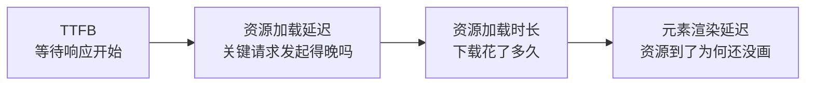

打开商品页，标题已经出来，主图却还在等；商品显示后，点击按钮没有反应；准备点击时，新加载的内容又把按钮挤走了。

只说“页面慢”，很难判断该改哪里。先用指标分清问题出在加载、交互还是布局，再看浏览器记录里时间花在了什么地方。

# 页面慢，先分清慢在哪里

| 看到的现象 | 先看什么 | 它回答的问题 |
| --- | --- | --- |
| 打开页面后，服务器迟迟没有开始响应 | TTFB | 多久收到响应的第一个字节？ |
| 页面长时间没有任何内容 | FCP | 多久第一次画出文本、图片等内容？ |
| 标题出来了，最大的内容还在等待 | LCP | 视口内最大的合格内容何时呈现？ |
| 点击、输入后，页面迟迟不给反馈 | INP | 交互发生后，多久画出下一次反馈？ |
| 阅读或点击时，已有内容突然移动 | CLS | 页面发生了多严重的意外布局偏移？ |
| 想先检查加载期间的主线程阻塞 | TBT | 长任务中可能阻塞交互的时间有多少？ |

其中，LCP、INP、CLS 是当前的核心 Web 指标，分别衡量加载、交互和视觉稳定性。TTFB、FCP、TBT 是排查问题时常用的辅助指标。

| 核心指标 | 良好 | 需要改进 | 较差 |
| --- | --- | --- | --- |
| LCP | ≤ 2.5 秒 | > 2.5 且 ≤ 4 秒 | > 4 秒 |
| INP | ≤ 200 毫秒 | > 200 且 ≤ 500 毫秒 | > 500 毫秒 |
| CLS | ≤ 0.1 | > 0.1 且 ≤ 0.25 | > 0.25 |

这张表用于判断线上表现时，要看真实访问的第 75 百分位，即 p75，并将移动端、桌面端分开统计。例如 LCP 的 p75 为 2.5 秒，意味着至少约 75% 的访问在这个时间内完成了 LCP。三项指标各自统计；本机一次访问得到绿色分数，只能说明这次访问的表现。[Web Vitals 的指标与阈值](https://web.dev/articles/vitals)

# 用 Network 找请求，用 Performance 找呈现

在 macOS 上按 `Command + Option + I`，Windows 上按 `F12`，打开 Chrome DevTools。

## Network：浏览器发出了什么请求

打开 Network，再刷新页面，列表里就会出现这次加载的请求。先看下面几项：

| 列或详情页 | 关注什么 |
| --- | --- |
| Name、Type | 请求了什么；是页面文档、脚本、图片，还是数据接口 |
| Initiator（启动器） | 谁发起了请求；它是不是要等某段 JS 执行后才出现 |
| Waterfall（瀑布图） | 请求什么时候开始，哪些请求前后依赖、哪些可以重叠 |
| Response（响应） | 服务器原始返回的 HTML、JSON 或脚本 |
| Timing（时间） | 排队、建连、等待响应和下载分别用了多久 |

Network 能把请求的先后关系和传输过程展示出来。资源下载完后，浏览器还可能要执行脚本、生成节点、计算布局、绘制，所以请求总时间与 FCP、LCP 衡量的不是同一件事。

比较两版的首次加载时，可以勾选 Disable cache，让两次都重新请求资源；复访体验则保留正常缓存，单独观察。Disable cache 只影响缓存，JavaScript 仍会执行。[Network 面板参考](https://developer.chrome.com/docs/devtools/network/reference)

## Performance：资源到了以后，浏览器在做什么

Performance 要分清两个界面：刚打开时的**实时指标页**，以及录制结束后的**时间轴**。实时页显示这次访问当前的 LCP、INP、CLS；时间轴记录一段时间里发生的请求、脚本执行、绘制、交互和布局偏移。

录制按钮也有区别：

- **Record and reload（录制并重新加载）**：刷新页面并记录加载过程，适合分析 FCP、LCP。默认会在加载后不久停止，未必覆盖很晚才发生的更新。
- **Record（录制）**：从现在开始记录，不会自动刷新。录制后实际点击或输入，再停止，适合分析交互；也可以先开始录制、再手动刷新，让记录覆盖需要观察的完整过程。

如果需要对照画面，要提前开启 Screenshots。录制结束后，沿 FCP、LCP 标记看截图；交互看 Interactions，偏移看 Layout shifts，主线程工作看同一时段的 Main 轨道。[Performance 的实时指标与录制入口](https://developer.chrome.com/docs/devtools/performance/overview)

首屏录制时保持页面在前台，先不滚动、点击。比较改动前后，固定视口、设备、网络、CPU 和缓存条件，业务项目尽量使用生产模式，免得把缓存命中或环境变化当成优化效果。

## 一次录制能得到哪些指标

假设操作是“录制并重新加载，等待页面出现，然后结束”，可以按这张表读结果：

| 指标 | 这次录制能看到什么 | 要补充什么操作 |
| --- | --- | --- |
| TTFB | 主文档请求及相关时间分段；部分诊断中会显示 TTFB | 最直接的入口是 Network → 主文档 → Timing；注意请求 Waiting 段和完整导航 TTFB 的区别 |
| FCP | FCP 标记、时间，以及开启截图采集后的对应画面 | 要覆盖页面加载，不能在内容已经出现后才开始录 |
| LCP | LCP 标记、对应元素和相关加载记录 | 保持前台，覆盖关注的内容加载；太早停止可能漏掉后续候选 |
| CLS | 录制窗口内的布局偏移和偏移簇 | 后续异步加载、滚动加载也可能产生偏移，要把相关过程录进去 |
| INP | 仅刷新而不操作，不会因此得到 INP | 实际点击或输入后，看 Interactions 中的交互；页面当前代表 INP 看实时指标页 |
| TBT | Main 中可以分析长任务，但不要默认这里会给出 Lighthouse 的 TBT 数值 | 在 Lighthouse 的 Performance 报告中读 TBT，再用 Performance 定位长任务 |

**一段录制只覆盖一个观察窗口。** 例如只录了加载后的几秒，就不知道用户稍后展开列表是否卡顿；录制期间没有位移，也无法保证后面不会发生。Interactions 中某次点击的耗时，与整次访问选出的代表 INP 也要分开。[Performance 时间轴中的标记、交互与位移](https://developer.chrome.com/docs/devtools/performance/reference#view-performance-markers)

## 哪些情况需要 API 获取

上面这几项标准指标，**本地排查都不要求先写 API**。需要在用户浏览时自动采集、接入监控或记录自定义业务耗时，再在应用里读取和上报数据；API 也可以用于临时调试。

浏览器提供原始计时条目，工具或库再按规则计算指标。可以先认清下面的对应关系，不必自己实现一遍计算：

| 指标 | 浏览器提供的原始数据 | 常用采集方式 |
| --- | --- | --- |
| TTFB | Navigation Timing，主文档导航的时间戳 | `web-vitals` 的 `onTTFB` |
| FCP | Paint Timing 中的 `first-contentful-paint` | `onFCP` |
| LCP | `largest-contentful-paint` 候选条目 | `onLCP` |
| INP | Event Timing 中的原始交互记录 | `onINP`，负责交互归并和代表值选取 |
| CLS | `layout-shift` 条目 | `onCLS`，负责过滤和会话窗口计算 |
| TBT | 长任务条目可以辅助分析，没有直接叫 TBT 的标准条目 | 优先使用 Lighthouse 的报告；`web-vitals` 没有 `onTBT` |

例如业务项目要持续采集核心 Web 指标，可以在客户端入口初始化一次：

```js
import { onLCP, onINP, onCLS } from 'web-vitals';

function report(metric) {
  console.log(metric.name, metric.value, metric.rating);
}

onLCP(report);
onINP(report);
onCLS(report);
```

这里先用 Console 展示结果；真正接入监控时，再将回调中的数据交给上报逻辑。LCP、INP 的值以毫秒计，CLS 是分数。不同指标的回调时机不同，有些要等交互或页面隐藏后才报告；没有合格交互时，INP 不会凭空变成零。[web-vitals 的用法与回调规则](https://github.com/GoogleChrome/web-vitals#usage)

原始条目也不一定能直接当作最终指标：LCP 有候选更新和可见性规则，CLS 要过滤并聚合，INP 要从交互中选代表值。正式监控通常交给 `web-vitals` 或已有监控 SDK 处理。本地想查看一次 LCP 对应谁，则可以直接看面板，或用后文的调试代码读取元素。

如果要记录某个业务流程耗时，可以自行定义起止点，使用 `performance.mark()`、`performance.measure()`。它们不会自动变成 LCP。另一个边界是：页面 API 不会完整提供 DevTools 的截图和 Main 火焰图；浏览器录制的 trace 包含更多诊断信息。[自定义计时在 Performance 中的展示](https://developer.chrome.com/docs/devtools/performance/reference#view-custom-timings)

# 加载阶段：沿着 TTFB、FCP、LCP 找等待

## TTFB：第一个字节为什么来得晚

TTFB（Time to First Byte）从导航开始计时，到收到响应首字节结束。重定向、DNS 查询、建连、网络往返、服务端准备响应，都可能占用这段时间。TTFB 高时，先看时间分布，才能知道要查网络还是服务端。[TTFB 的定义](https://web.dev/articles/ttfb)

在 Network 中选主文档请求，也就是类型为 document 的那一行，打开 Timing。先看建连相关阶段，再看 Waiting for server response / Waiting (TTFB)。

**Waiting 显示的是这次请求等待响应首字节的时间**，包括网络往返和服务端准备响应。排队、DNS、连接另列，存在重定向时，前面还有其他文档请求。这些都要一起看，才能解释从导航起算的完整 TTFB。[Timing 各阶段的含义](https://developer.chrome.com/docs/devtools/network/reference#timing-explanation)

找到耗时最多的阶段，再决定改哪里：

| 等待集中在哪里 | 接下来查什么 | 可考虑的改动 |
| --- | --- | --- |
| 多次重定向 | 是否先跳协议、再跳域名、再跳登录入口 | 合并可避免的跳转，让入口尽量直达目标 |
| 建连或网络往返 | 用户与服务节点的距离、连接是否复用 | 合适的 CDN / 边缘节点、连接复用 |
| 等服务端开始返回 | 数据请求、渲染、缓存是否命中 | 减少重复取数，让独立请求并行，按内容适用范围缓存 |

如果时间花在服务端，浏览器记录只能看到等待有多长，具体的数据请求、渲染和缓存耗时还要结合服务端日志或计时拆开。[优化 TTFB](https://web.dev/articles/optimize-ttfb)

TTFB 到收到首字节就结束了。服务器即使很快返回空容器，后面的正文也可能还要等很久，这就需要继续看绘制指标。

## FCP：第一次有内容，画出的是什么

FCP（First Contentful Paint）从导航开始，记录第一次画出文本、图片等内容的时间。Logo 或“加载中”文字都可能触发它，因此 FCP 出现时，商品、文章正文乃至整个首屏都可能还没准备好。[FCP 的定义](https://web.dev/articles/fcp)

在 Performance 的加载记录里找到 FCP 标记，对照同一时刻的截图，确认第一次画出的是加载提示，还是用户要看的内容。

FCP 晚时，顺着 HTML 是否到达往下查：

- **HTML 还没有开始到达**：回到 TTFB，优先缩短前面的等待。
- **HTML 已经到达，页面还没有内容**：检查渲染阻塞资源、主线程工作，以及正文是否仍要等待客户端取数和生成。

Render-blocking requests 诊断会列出阻塞首次绘制的资源。首帧不需要的工作可以延后，必需的 CSS、脚本则先减少不必要的内容和依赖。`defer`、`async` 能改变脚本下载、执行与解析的关系，执行成本本身仍需要处理。[渲染阻塞请求的诊断与处理](https://developer.chrome.com/docs/performance/insights/render-blocking)

字体也可能让文本迟迟不显示。选择加载与回退策略时，既要让文字尽早可读，也要看字体替换后是否重新换行、改变高度，造成布局偏移。[字体与性能](https://web.dev/articles/font-best-practices)

## LCP：最大的内容，到底卡在哪一段

### LCP 对应的是哪个对象

LCP（Largest Contentful Paint）要同时看**时间值**和**对应元素**：值表示从导航开始，到该内容呈现用了多久；元素则告诉你，这次记录的是页面上的哪张图、哪个标题或文本块。

**JS bundle 本身不是 LCP 元素。** 浏览器按规则挑选视口内的合格可见内容，“最大”看的是内容面积，不是下载文件的字节数。页面可以有很大的 JS 文件，但 LCP 对应的仍可能是一张商品图。[LCP 的候选类型与尺寸规则](https://web.dev/articles/lcp)

例如页面里有这几个节点：

```html
<h1>晨光马克杯</h1>

<script src="/assets/app.js" defer></script>
```

如果最后选中的元素是 `img#hero`，LCP 就是在记录这张图何时呈现。假设值为 2.3 秒，意思是从导航开始到它呈现用了 2.3 秒，不代表图片本身下载了 2.3 秒。

`/assets/app.js` 可能让这张图晚出现：例如页面要等它执行后才创建图片节点，或者它的长任务阻碍了绘制。此时 bundle 是影响因素，图片才是被计量的内容。

它的候选会随加载更新：标题先出现，主图随后出现，主图就可能替代标题。分析时要找到最后的有效候选。首次交互后会停止报告后续候选；后台打开页面、首次隐藏后产生的条目也要按规则排除，这也是录首屏时应保持前台、暂不操作的原因。[LCP 的候选与计量规则](https://web.dev/articles/lcp)

### 在 Chrome 里确认它是谁

最快的办法，是在 Performance 的实时指标页找到 **LCP element**，悬停查看页面中高亮的内容。这样还不用读完整条时间轴，就能先知道当前选中的是谁。[实时指标页的 LCP 元素](https://developer.chrome.com/docs/devtools/performance/reference#live-metrics-screen)

需要继续追原因时，再录制一次加载：

1. 选择 **Record and reload**，保持页面前台，先不滚动或点击。
2. 在结果里选 **LCP 标记**，查看详情 / Summary 中的元素链接。部分版本显示为 **Related node**，也可以从 **Insights → LCP breakdown** 查看相关信息。
3. 悬停元素链接，在页面里确认高亮范围；通过元素链接或 **Reveal in Elements** 定位到 Elements，查看实际节点。
4. 如果是图片，沿图片 URL 找 Network 请求，检查何时发起、谁发起、下载多久；如果是文本，没有独立图片 URL 很正常，要继续查 HTML、字体和绘制阻塞。

读完这几步，应该能明确说出“这次 LCP 是 `img#hero`”，再分析相关请求。不要根据 Network 里哪个文件最大来猜。[LCP 元素的节点定位](https://developer.chrome.com/blog/new-in-devtools-78#largest-contentful-paint-in-the-performance-panel)、[LCP 图片请求的发现](https://developer.chrome.com/docs/performance/insights/lcp-discovery)

### 用 API 查看候选元素

如果想在 Console 中直接查看对象，可以用下面这段调试代码：

```js
new PerformanceObserver((list) => {
  for (const entry of list.getEntries()) {
    console.log('LCP 候选', {
      element: entry.element,     // 对应的 DOM 节点，可能为 null
      url: entry.url || null,      // 图片等资源的 URL；文本通常为空
      size: entry.size,            // 内容面积，不是文件字节数
      startTime: entry.startTime,  // 相对本次导航的时间，单位 ms
    });
  }
}).observe({
  type: 'largest-contentful-paint',
  buffered: true,
});
```

这里打印的是 `LargestContentfulPaint` 条目：`entry` 是记录对象，`entry.element` 才是对应的页面节点。`buffered: true` 会请求浏览器缓冲的已有条目，所以在加载后运行，也可能看到此前的候选。[LargestContentfulPaint API](https://developer.mozilla.org/en-US/docs/Web/API/LargestContentfulPaint)

候选变化时可能打印多条。这段代码用于辨认元素，没有实现完整的指标过滤；不要把任意一条输出直接作为线上 LCP。正式统计仍可使用前面的 `onLCP`。

### 找到元素后，再拆解等待

确定元素和相关资源后，再看 LCP breakdown 的四个分段：



四段相加就是这次 LCP。系统字体渲染的文本如果无需加载独立资源，中间两段可以为零；使用 Web 字体时，还要检查关键字体的加载。文本 LCP 也能这样分析。[LCP breakdown 的分段说明](https://developer.chrome.com/docs/performance/insights/lcp-breakdown)

**请求发起晚，先解决发现和调度。** 如果主图要等“下载 JS → 请求接口 → 返回图片地址 → 创建图片”，图片再小，也得等前面的步骤。让关键图片地址直接出现在初始 HTML 中，可以让浏览器更早发现它；确有需要时，再考虑预加载或提高优先级。首屏 LCP 图片通常不应懒加载。

**下载耗时长，再处理传输。** 对照实际展示尺寸检查原图，选择合适的编码、响应式图片、缓存和资源服务，避免手机只展示几百像素，却下载一张大图。

**资源已到却没画出来，继续查呈现。** 这时要查样式、字体、主线程任务，以及组件是否仍把内容隐藏着；大规模 DOM 更新和布局也可能拖慢呈现。如果阻塞发生在这里，压缩图片省下的下载时间未必能体现到 LCP 上。[按阶段优化 LCP](https://web.dev/articles/optimize-lcp)

# 交互阶段：用 INP 找到反馈为什么迟到

INP（Interaction to Next Paint）从点击、点按、键盘等交互发生开始，关注到下一次画面呈现用了多久。这段时间包括：

| 阶段 | 发生了什么 | 在记录里查什么 |
| --- | --- | --- |
| 输入延迟 | 用户已经操作，事件处理还没开始 | 此前是否有任务占着主线程 |
| 处理耗时 | 相关事件回调正在执行 | 回调里有哪些计算、同步工作和状态更新 |
| 呈现延迟 | 回调结束，下一帧还没呈现 | 样式、布局、绘制等后续工作 |

一次访问的 INP 通常对应最慢交互；交互很多时，会按规则忽略少量极端值。它既不是所有点击的平均耗时，也不是随便选中一次点击得到的数值。没有合格交互时，就没有 INP 结果。[INP 的定义与选取规则](https://web.dev/articles/inp)

先复现那个迟钝的操作，看看 Performance 的实时交互记录。需要查原因时，录下操作，选中 Interactions 中的对应交互，再沿同一时间段查看 Main 轨道。

**输入延迟高**，就看事件开始前谁占着主线程。初始化、第三方脚本或其他长任务，都可能让用户输入排队，先减少这些竞争工作。

**处理耗时高**，再展开事件回调。必要的反馈优先完成，非关键工作延后；计算可以分块并让出主线程，适合独立计算的部分可以考虑 Worker。只把函数改成 `async`，或把工作放进 Promise 微任务，仍不保证浏览器能获得绘制机会。

**呈现延迟高**，重点看回调结束后的更新成本：是否一次更新大量节点，是否改完样式又反复读取布局。框架项目还要看这次状态变化实际触发了多少组件和 DOM 更新。[分阶段优化 INP](https://web.dev/articles/optimize-inp)

例如点击“提交”后，页面先显示“提交中”，再等待接口结果。INP 关注交互后的下一次呈现；接口多久返回、业务何时完成，要另外记录。及时显示状态可以改善反馈，接口是否仍然很慢，还要看后两项记录。

## TBT：加载期间的阻塞线索

Lighthouse 的 Performance 报告里还有 TBT（Total Blocking Time）。常见页面加载审计会在 FCP 到 TTI 的区间内，累加各长任务超过 50 毫秒的部分；其他工具或测量模式可能使用不同区间。

例如，一个 70 毫秒任务贡献 20 毫秒，一个 120 毫秒任务贡献 70 毫秒，一个 40 毫秒任务不贡献阻塞时间，合计 90 毫秒。TBT 统计的是超出的部分，并非脚本总执行时间。[Lighthouse 的 TBT 计算](https://developer.chrome.com/docs/lighthouse/performance/lighthouse-total-blocking-time)

TBT 高时，回到 Performance 查看启动阶段的长任务，检查脚本编译、执行和第三方初始化。它可以提示交互风险，但用户稍后展开列表、提交表单时的表现，仍要通过实际交互测量 INP。[TBT 与交互指标的关系](https://web.dev/articles/tbt)

# 布局稳定：用 CLS 找到是谁把内容推走了

CLS（Cumulative Layout Shift）衡量意外布局偏移，没有毫秒单位。它取累计偏移分数最高的会话窗口：相邻偏移间隔小于 1 秒，窗口最长 5 秒。因此，一次访问的 CLS 取决于其中一段最严重的连续偏移，而非整个生命周期所有偏移的总和。

离散输入后 500 毫秒内、标记为近期输入的偏移通常不计入 CLS，滚动本身没有这项豁免。页面有异步加载或滚动加载时，要继续观察后续过程，首次 load 结束并不代表布局已经稳定。[CLS 的计算规则](https://web.dev/articles/cls)

在 Performance 的 Layout shifts 轨道选中偏移事件或簇，查看分数、时间、受影响元素，再对照前后截图。

**受影响元素未必是原因。** 正文向下移动，可能只是上方图片加载后撑开了空间。此时应处理图片的占位，而不是修改被挤走的正文。

优化时，要让初始布局提前知道后面的内容会占多大位置：

- 图片、视频提供正确的宽高或比例，让浏览器提前预留空间。
- 广告、推荐位、异步模块使用与实际内容相符的占位尺寸。
- 字体回退与最终字体尽量匹配尺寸，检查替换后的换行和高度。
- 新内容优先放在合适的位置，避免无预留地插到用户正在阅读的内容上方。

预留之后还要在实际视口检查。占位与最终内容尺寸相差太大，替换时仍会推动周围内容。[优化 CLS](https://web.dev/articles/optimize-cls)

# 用一个小例子理解 SSR 改变了什么

如果商品信息要等浏览器加载 JS、请求数据后才能出现，服务端提前生成商品 HTML，就能减少客户端生成正文的依赖。代价是服务端也要等数据、生成页面，TTFB 可能增加。因此，需要同时看响应何时开始、正文何时出现。[渲染方式与性能的取舍](https://web.dev/articles/rendering-on-the-web)

配套示例用原生 Node.js、HTML、CSS 和 JavaScript 实现，没有框架、构建步骤或人为延迟。两条路径共用商品数据、模板、样式和按钮脚本：

- `/ssr`：Node 读取数据，将商品 HTML 放进页面响应。
- `/csr`：先返回空商品容器，浏览器请求 `/api/product` 后再填入商品 HTML。

在 Network 里选中文档请求，打开 Response，对比商品区域：

```html
<!-- CSR：服务器返回空容器 -->
<section id="product" aria-label="商品信息"></section>

<!-- SSR：服务器返回的容器中已有商品正文，其他内容省略 -->
<section id="product" aria-label="商品信息">
  <article class="product">
    <div class="product-info">
      <h2>晨光马克杯</h2>
    </div>
  </article>
</section>
```

再看 Fetch/XHR，CSR 会出现一次商品数据请求，SSR 没有这次请求。SSR 的取数发生在 Node 中，成本仍在，只是不会显示为浏览器请求。禁用 JavaScript 后重新刷新，SSR 仍有商品正文，CSR 的商品区域为空。

| 指标 | 这条链路可能带来的变化 |
| --- | --- |
| TTFB | 等数据、生成 HTML 可能增加等待；缓存等措施可以影响结果 |
| FCP、LCP | 正文随初始 HTML 到达，有机会更早呈现；公共标题已触发 FCP 时，FCP 也可能接近 |
| INP、TBT | 仍要看客户端实际执行的脚本；本例两页共用脚本，不能据此声称改善 |
| CLS | 仍取决于占位、尺寸和后续更新，SSR 不自动保证布局稳定 |

两页的计数按钮都要靠 JS 绑定事件，使用的是原生 `addEventListener`。这个示例只看商品正文在哪生成、是否随 HTML 响应返回；没有测量性能提升，也不模拟 React 水合成本。

[下载完整示例源码](/downloads/native-csr-ssr-demo.zip)，解压后进入 `simple-ssr`，运行 `npm start`，分别打开 `http://127.0.0.1:4174/ssr` 和 `http://127.0.0.1:4174/csr`。源码阅读顺序和 Network 观察步骤见包内 README。

# 改完以后，怎么判断是否有效

保存原始记录，复现同一个问题，再针对耗时最明显的阶段修改。主图请求发起晚，就验证改动能否让它更早开始；如果只缩小了图片，发起时机没变，还要继续查前面的等待是否仍在拖慢 LCP。

本地复测沿用相同操作和环境，多看几次时间分段、候选元素和截图。总分变好时，也要确认耗时确实减少了，而不只是从一段挪到另一段。

上线后，再比较相同设备和用户条件下的真实访问分布，看加载、交互和布局是否改善。本地记录解释这次访问为什么慢，真实用户数据则检验改动是否解决了实际问题。
