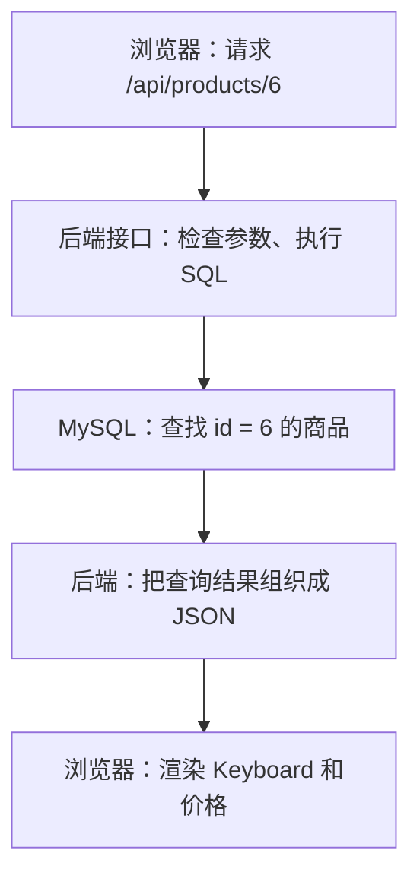
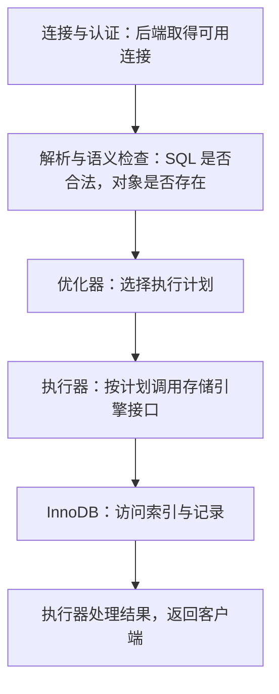

假设你已经能写一个商品列表页面：用 `fetch` 请求接口，把返回的数组交给 React 渲染。现在要把商品真正存起来，并支持按编号查详情。

前端写的是 `fetch('/api/products/6')`。接口背后的 MySQL 怎么找到第 6 号商品？它会像 JavaScript 的 `array.find()` 一样，从头检查每个对象吗？

这篇从一张只有 12 条记录的商品表开始。先亲手运行 SQL，再把视角从表里的行移到数据页，最后沿着一棵 B+ 树找到同一条记录。不要求你提前会 SQL，也不要求你学过树。

整个系列分为三篇：

| 篇目 | 要回答的问题 |
| --- | --- |
| 第一篇：查询、数据页与 B+ 树（本文） | 数据存在哪里，索引怎样找到一行？ |
| 第二篇：联合索引与查询优化（待续） | 商品列表变慢后，怎样选索引、读执行计划？ |
| 第三篇：事务、并发与日志（待续） | 两个人同时下单，怎样正确扣库存，失败后怎么办？ |

本文以 **MySQL 8.4、InnoDB 存储引擎**为基线。所有索引图都是教学示意，图中少量记录和页容量是为了方便推演，不代表实际数据库文件布局。

# 一、先把页面、接口和数据库接起来

一个商品详情请求，可以分成三段：



浏览器与后端之间说的是 HTTP，后端与 MySQL 之间通过数据库驱动通信。**SQL 是我们向数据库描述读写要求的语言。** 后端取得查询结果，再决定返回哪些 JSON 字段。

因此，下面两段代码虽然都在“找商品”，执行位置和处理方式不同：

```js
// 已经把商品数组拿到 JavaScript 内存中，再逐个检查。
const product = products.find(item => item.id === 6);
```

```sql
-- 把查找条件交给 MySQL，由它决定具体怎样找。
SELECT id, name, price, stock
FROM products
WHERE id = 6;
```

`-- ` 开头的是 SQL 注释。`SELECT` 指定返回哪些列，`FROM` 指定表，`WHERE` 指定筛选条件。分号表示这一条语句结束。

这段 SQL 没有规定“从第一行循环到第六行”，也没有规定“必须使用某棵树”。**我们描述想要什么，数据库选择取得它的路径。** 后面讲到的优化器，就负责选择执行计划。

真正接入后端时，应由服务端驱动绑定查询参数，不要把用户输入直接拼进 SQL 字符串。本文先使用固定的编号 6，专注理解数据库内部的查找过程。

# 二、建立第一张商品表

## 库、表、行、列和主键

先用前端熟悉的数据做参照：

```js
const product = {
  id: 6,
  name: 'Keyboard',
  category: 'office',
  price: '199.00',
  stock: 15,
};
```

数据库里也要保存这些信息，但会先声明每一列的类型和约束。这里用字符串表示金额，只是避免在 JavaScript 示例中把金额与浮点计算混在一起；实际驱动返回什么类型，要看驱动配置。

| 名称 | 本文例子 | 怎样理解 |
| --- | --- | --- |
| 数据库 | `mysql_frontend_lab` | 组织一组相关表的命名空间 |
| 表 | `products` | 保存商品记录，列的定义由所有行共享 |
| 行，也叫记录 | 编号 6 的商品 | 一条具体的数据 |
| 列，也叫字段 | `name`、`price` | 这条记录的一个属性 |
| 主键 | `id` | 在表中唯一标识一行，不能重复，也不能为 NULL |

主键可以帮助接口稳定地指向某件商品。商品改名后，`id = 6` 仍然能找到它。**编号 6 不表示“数组第六个位置”**；即使删除编号 2，编号 6 也不会因此变成 5。

## 先准备可以执行 SQL 的地方

如果你已有本地 MySQL，可以在数据库客户端里打开一个 SQL 编辑窗口。没有环境的话，[示例运行说明](/examples/mysql/README.md) 提供了一个临时 MySQL 8.4 Docker 容器的启动方式。

后面的 `sql` 代码都在 **MySQL 客户端**中执行，不是直接粘进普通终端。你也可以下载并依次运行两个完整文件：

1. [01-setup.sql：建库、建表和 12 条商品数据](/examples/mysql/01-setup.sql)
2. [01-queries.sql：查询、索引查看和执行计划实验](/examples/mysql/01-queries.sql)

先看建表部分，每个声明都对应一个明确用途：

```sql
CREATE DATABASE IF NOT EXISTS mysql_frontend_lab
  CHARACTER SET utf8mb4;

USE mysql_frontend_lab;

CREATE TABLE IF NOT EXISTS products (
  id BIGINT UNSIGNED NOT NULL,
  name VARCHAR(80) NOT NULL,
  category VARCHAR(20) NOT NULL,
  price DECIMAL(10, 2) NOT NULL,
  stock INT UNSIGNED NOT NULL,
  PRIMARY KEY (id),
  INDEX idx_category (category)
) ENGINE = InnoDB;
```

`USE` 选择接下来操作的数据库。`CREATE TABLE` 声明表结构，括号中的内容可以这样读：

- `id` 使用无符号大整数；这里手动填编号，便于让 SQL 和插图一一对应。
- `VARCHAR(80)` 表示最多 80 个字符的变长字符串；字符数与占用字节数不是一回事。
- `DECIMAL(10, 2)` 表示总共最多 10 位数字，其中小数部分占 2 位，适合本例的金额。
- `stock` 使用无符号整数保存库存，`NOT NULL` 表示不能缺失这个值。
- `PRIMARY KEY (id)` 声明主键，`INDEX idx_category (category)` 创建按分类查找的辅助索引。
- `ENGINE = InnoDB` 指定负责底层存取的存储引擎。本文讨论的数据页和索引组织方式，都以它为前提。

类型和约束能替我们挡住一部分无效数据，但“下单成功必须扣库存”等跨操作的业务规则，还需要第三篇的事务与并发控制。

初始化文件会插入下面 12 条记录。图里沿用这些编号与名称：

| id | name | category | price | stock |
| --- | --- | --- | --- | --- |
| 1 | Notebook | stationery | 12.50 | 100 |
| 2 | Desk lamp | office | 89.00 | 20 |
| 3 | Pen | stationery | 3.00 | 200 |
| 4 | Mug | home | 25.00 | 60 |
| 5 | Mouse | electronics | 59.00 | 40 |
| 6 | Keyboard | office | 199.00 | 15 |
| 7 | Cable | electronics | 19.90 | 80 |
| 8 | Towel | home | 15.00 | 50 |
| 9 | Eraser | stationery | 2.00 | 150 |
| 10 | Monitor | office | 899.00 | 8 |
| 11 | Charger | electronics | 79.00 | 30 |
| 12 | Basket | home | 35.00 | 25 |

单条插入语句的写法如下。完整初始化文件会处理这些记录，并在重复执行时保留已有相同主键的数据；已经导入文件，就不必再单独执行这条普通 `INSERT`。

```sql
INSERT INTO products (id, name, category, price, stock)
VALUES (6, 'Keyboard', 'office', 199.00, 15);
```

## 用三条查询观察数据

先按主键取商品：

```sql
SELECT id, name, price, stock
FROM products
WHERE id = 6;
```

在刚初始化的数据里，结果是：

```text
id  name      price   stock
6   Keyboard  199.00  15
```

再取一段编号：

```sql
SELECT id, name
FROM products
WHERE id BETWEEN 5 AND 8
ORDER BY id;
```

`BETWEEN` 包含两端，因此返回 Mouse、Keyboard、Cable、Towel 四行。`ORDER BY id` 要求结果按编号升序排列。**如果需要稳定顺序，就写出 ORDER BY，不要依赖某次查询碰巧返回的顺序。**

最后按分类查询：

```sql
SELECT id, name, price
FROM products
WHERE category = 'office'
ORDER BY id;
```

结果是编号 2、6、10 的商品。第一条按 `id` 查，第三条按 `category` 查，表面上都只改了 `WHERE`，底层可用的查找路径却不同。

# 三、一条 SELECT 在 MySQL 里经过什么

先把 MySQL 看成协作的两部分：**Server 层理解和执行 SQL，存储引擎负责具体的数据组织与访问。**



这是一张职责图，把语法解析和名称解析等准备工作合并展示，省略权限检查、锁与清理等细节。后端通常会复用连接池中的连接，不代表每条 SQL 都重新建立一次连接。MySQL 8.0 起已经移除了旧的查询缓存，所以这里没有“先查 SQL 结果缓存”这一步。[官方说明：查询缓存](https://dev.mysql.com/doc/refman/8.0/en/query-cache.html)

把 `SELECT ... WHERE id = 6` 放进去看：

1. MySQL 理解这条语句，确认要访问的表和列。
2. 优化器发现 `id` 有主键索引，可以考虑直接定位这一行。
3. 执行器按照选定的计划，调用 InnoDB 取得记录。
4. 需要返回的字段被送回客户端，后端再组织接口响应。

索引参与的是“怎样取得记录”。但要理解它为什么能加速，先得往下看：InnoDB 存放和读取数据时，并不是每次只搬一个 JavaScript 对象。

# 四、从一张表，走到一个数据页

## 页是装记录的单位

InnoDB 将索引记录组织在一个个页中。可以先把页想成一个能装多条记录的小盒子，每个盒子还有管理信息，而不是每行都拥有一个独立文件。

InnoDB 索引页的默认大小是 **16 KiB，也就是 16 × 1024 字节**。页大小可以在初始化实例时配置，所以不能把“所有 MySQL 页永远都是 16 KiB”当作定律。[官方说明：InnoDB 索引的物理结构](https://dev.mysql.com/doc/refman/8.4/en/innodb-physical-structure.html)


一页能放多少条记录，取决于行有多大、页里有哪些额外信息以及页的利用情况。`id` 和短名称组成的行，与包含很长文本的行，不能按同样数量估算。

本文后面为了把树画出来，会假设一个叶子页只装四行。**这是教学容量，不是 InnoDB 的真实上限；我们插入的 12 条短记录通常足以放在一个叶子页里。**

## 访问一页，不一定读取一次磁盘

页还可能已经在内存中。InnoDB 的 **Buffer Pool**（缓冲池）会缓存数据页和索引页：需要访问的页已在缓冲池里，就能直接在内存中处理；不在时，才需要把页读进来。[官方说明：Buffer Pool](https://dev.mysql.com/doc/refman/8.4/en/innodb-buffer-pool.html)

因此，后面说“沿着树访问三个页”，是在数逻辑访问的页，不能直接宣称“一定发生三次磁盘 I/O”。树的上层页经常被访问，也更有机会留在缓冲池中。

有了页这个单位，我们可以把查找拆成两个问题：

1. **页内查找：** 目标页里装了很多记录，怎样找到其中一行？
2. **页间查找：** 一张表有很多页，怎样知道该去哪个页？

页目录帮助解决第一个问题，B+ 树把第二个问题组织起来。

# 五、页内查找：先查目录，再沿记录链走几步

先只看主键索引的一个叶子页。页中的用户记录会按主键顺序建立记录链：记录头里的下一条记录信息，把它们按顺序连接起来。

这里的“有序”说的是**沿链访问的键值顺序**。记录在页中的物理位置不必紧挨着排成数组，图中的方块位置也只是为了方便阅读。

如果一页里有很多记录，每次都从第一条沿链走到目标，仍然要做不少比较。于是 InnoDB 在页里维护一个较稀疏的目录：**页目录（Page Directory）**。

## 目录槽保存什么

页目录由多个槽（slot）组成。可以把槽理解成“通往某条记录的页内位置”，每个槽指向它所负责记录组的最后一条记录。

普通组通常包含 4～8 条记录，首尾涉及系统记录的组有例外。这是 InnoDB 实现中的分组规则，不表示一页只能放 4～8 行。页内还有 `infimum`、`supremum` 两条表示边界的系统记录，下面只画中间的一段，省略它们和首尾槽。[官方源码：页目录约定](https://github.com/mysql/mysql-server/blob/mysql-8.4.0/storage/innobase/include/page0page.h)


## 沿图查一次 id = 6

假设图中的两个相邻目录槽，分别指向主键 4 和 8：

1. 对目录槽做二分查找，通过它们指向的记录比较主键，确定 `4 < 6 <= 8`。
2. 这说明目标如果存在，就在 4 后面、8 以内的那组记录里。
3. 从前一个边界记录 4 的下一条开始，沿记录链依次比较 5、6，找到目标。

**目录没有直接指向每一条记录。** 它先把范围缩小到一个小组，再用很短的链式查找完成定位。官方查找实现也明确分为目录二分与组内线性查找两个阶段。[官方源码：页内查找](https://github.com/mysql/mysql-server/blob/mysql-8.4.0/storage/innobase/page/page0cur.cc)

这也解释了为什么不能只说“数据页是一条链表，所以页内查询必须从头遍历”。链表与页目录是配合使用的。

图里展示的是页内机制。前面的 SQL 可以验证查询结果，却不能直接证明 MySQL 恰好按图中的方式把这 12 行分组；实际页布局还与插入、删除及页分裂历史有关。

# 六、页间查找：给数据页建立多层目录

一页内可以靠页目录找记录，但商品越来越多，数据需要分散到很多页。即使每页内部查找很快，逐页尝试也会产生大量访问。

我们需要在页的上方再加一层导航，告诉数据库：“这个键值应该去哪个子页找。”

## 从三个叶子页开始看树

下面把 12 条记录分成三个教学页：1～4、5～8、9～12。上方的根页保存导航键和子页信息，向下指向这些页。


先认识四个词：

| 术语 | 图中的含义 |
| --- | --- |
| 根节点 | 最上面的入口页，查找从这里开始 |
| 内部节点，也叫非叶子节点 | 保存导航键和子页信息，帮助缩小查找范围 |
| 叶子节点 | 没有下一层子页；主键索引的叶子记录保存行数据 |
| 树高 | 从根走到叶子经过的层数；这张图只有两层 |

图中的节点对应页，不是“一条商品记录就是一个树节点”。数据非常少时，根页本身也可以是叶子页，不需要单独的一层导航。

图用 1、5、9 表示简化的范围下界。实际 InnoDB 还有最左导航记录的特殊标记，父层导航键也不必始终等于子页当前最小记录；先把它理解为**用于划分范围的导航信息**即可。

## 查询 id = 6 怎样走

从根页开始看：

1. 比较导航范围，6 落在中间子页负责的范围里。
2. 顺着子页信息访问中间页。
3. 在该页内部，通过页目录和记录链找到编号 6。
4. 取到 Keyboard 对应的行数据，返回所需字段。

如果下面的页更多，一层根页放不下所有导航项，就可以在中间增加导航页。这种每个节点可指向多个子节点、叶子处于同一深度的组织方式，就是 **B+ 树**的核心形态。

注意“多路”：它并不是一个节点最多两个孩子的二叉树。一个导航页可以容纳很多键与子页信息，较少的层数就能覆盖较大的数据量。

## 为什么不用一棵二叉树

二叉搜索树也能缩小查找范围，但每个节点的分支数有限。面对大量记录，按页组织的多路树能用更少的层级导航到叶子；同一个内部页里，还可以一次看到很多分支信息。

这不是在说“二分查找不好”——页目录就会使用二分查找。要区分**比较方法**和**数据如何按页组织**这两件事。

B+ 树的内部节点主要放导航信息，用户记录集中在叶子层。与在内部节点也放用户记录的 B 树相比，在相似页大小和键大小等条件下，B+ 树的内部页可以容纳更多导航项，从而有利于降低树高。具体高度仍取决于键长度、行大小和页利用率，不能背成“三层永远能存多少条”。

## 查一个范围，为什么可以沿叶子继续走

回到第二条 SQL：

```sql
SELECT id, name
FROM products
WHERE id BETWEEN 5 AND 8
ORDER BY id;
```

可以先从根定位到范围起点 5，再顺序读到 8。如果范围跨过当前叶子页，就沿相邻叶子页的链接继续访问。

叶子页之间的顺序关系有利于范围扫描，不需要为范围内每一条记录都重新从根找一遍。但**逻辑相邻不等于磁盘物理地址连续**，更不能直接保证每次读取都是连续磁盘读。

作为对照，普通哈希索引擅长等值定位，却不天然提供这种按键值顺序继续扫描的能力。B+ 树能同时支持等值查找与范围查询，这是理解 MySQL 常见有序索引的重要理由。[官方说明：B-tree 与 Hash 索引比较](https://dev.mysql.com/doc/refman/8.4/en/index-btree-hash.html)

# 七、同一张表，可以有不同的索引树

前面一直按 `id` 查找。如果现在只有 `category = 'office'`，能不能直接用主键树选出一个很小的范围？

看看数据：office 商品的主键是 2、6、10，它们并不在主键顺序里连续相邻。主键树按 `id` 导航，并不能凭分类值直接确定一个狭窄的主键区间。

## 主键索引：叶子记录里就有行数据

我们显式定义了 `PRIMARY KEY (id)`。在这张 InnoDB 表里，主键索引就是**聚簇索引**：记录按主键组织，叶子记录保存行数据。

所以按主键查到 6 之后，不必再去另一份独立的“商品数组文件”按位置拿 name。该叶子记录就承载了这行的数据。

这里说的是便于理解的模型。很长的变长字段可能存到溢出页，叶子记录保留相应信息；“叶子记录保存行数据”不应被理解成“任何一行的所有字节都一定塞在同一个叶子页里”。[官方说明：InnoDB 行格式](https://dev.mysql.com/doc/refman/8.4/en/innodb-row-format.html)

如果没有显式主键，InnoDB 会选合适的非空唯一索引作为聚簇索引；再没有，就生成隐藏的行 ID 来组织它。**没有声明主键，不等于没有聚簇索引。** 本系列显式定义 `id`，避免让隐藏机制干扰理解。[官方说明：聚簇索引与二级索引](https://dev.mysql.com/doc/refman/8.4/en/innodb-index-types.html)

## 二级索引：先找到主键，再定位行

建表时还写了：

```sql
INDEX idx_category (category)
```

它让 InnoDB 维护另一套按分类组织的索引。除聚簇索引之外的索引，称为**二级索引**，也常叫辅助索引。

二级索引的叶子记录包含**索引列的值和该行的主键值**。我们的例子可以简化成：

```text
category       id
electronics     5
electronics     7
electronics    11
home            4
home            8
home           12
office          2
office          6
office         10
stationery      1
stationery      3
stationery      9
```

这样，office 对应的索引项就聚在一起了。字符串的具体比较顺序由字符集与排序规则决定；这里使用简单英文值帮助观察。


当执行下面的 SQL，**如果优化器选择这条二级索引路径**，可以这样推演：

```sql
SELECT id, name, price
FROM products
WHERE category = 'office'
ORDER BY id;
```

1. 在分类索引里定位 office，取得匹配记录的主键 2、6、10。
2. 分类索引本身没有 `name` 和 `price`，还需要取商品行。
3. 根据这些主键访问聚簇索引，取得所需列。图中只展开了 `id = 6` 的这一次。

**从二级索引取得主键后，再访问聚簇索引取数据，这个过程通常叫回表。** 主键值是逻辑标识，不是指向某块磁盘位置的固定物理地址。

现在就能理解一个常见面试追问：为什么主键过长会让二级索引也变大？因为每条二级索引记录里都带着主键列。[官方说明：二级索引与聚簇索引的关系](https://dev.mysql.com/doc/refman/8.4/en/innodb-index-types.html)

如果只要 `id` 和 `category`，所需列已经在这个二级索引中，就有机会仅靠索引取得结果，省去为获取额外列而回表。这就是下一篇要展开的**覆盖索引**；它是索引与具体查询之间的关系，不是一种单独的建索引语法。

# 八、做一次小实验，分清结果与执行路径

前面的图解释了“可能怎样查”，SQL 结果证明了“返回什么”。要看优化器实际选择的计划，可以在查询前加 `EXPLAIN`。这里指定 `FORMAT=TRADITIONAL`，让输出使用后面介绍的表格格式：

```sql
EXPLAIN FORMAT=TRADITIONAL
SELECT id, name, price, stock
FROM products
WHERE id = 6;

EXPLAIN FORMAT=TRADITIONAL
SELECT id, name, price
FROM products
WHERE category = 'office'
ORDER BY id;
```

先只看这几个字段：

| 字段 | 入门时怎样读 |
| --- | --- |
| `possible_keys` | 有哪些索引可能帮助这个查询，不等于最终选中 |
| `key` | 计划实际选择使用的索引；可能是 `PRIMARY`、`idx_category` 或 NULL |
| `type` | 访问方式，如主键等值定位、索引范围访问、全表扫描；不是耗时排名表 |
| `rows` | 优化器估计需要检查的行数，不是实际计时结果，也不是读取的页数 |

第一条在我们的表与数据下，通常会看到使用 `PRIMARY` 的主键等值访问。第二条**不保证一定选择 `idx_category`**：整张表才 12 行，直接扫描可能比走二级索引再取行更划算。

不能因为这次没选分类索引，就断言它“失效了”；也不能因为计划里出现了索引名称，就断言 SQL 已经足够快。数据规模、分布、查询需要的列，以及统计信息都会影响计划。[官方说明：EXPLAIN 输出](https://dev.mysql.com/doc/refman/8.4/en/explain-output.html)

这里也澄清一个容易混淆的概念：对 InnoDB 来说，全表扫描通常就是扫描聚簇索引的叶子记录。它不是“表里压根没有树”，而是没有通过有效的查找条件将扫描范围缩小。

本篇只要求你把“返回结果”和“访问路径”分清。`EXPLAIN` 不是页查看器，它不会把图中的根页、目录槽和具体页号打印出来。下一篇再用更合适的数据规模比较扫描量和执行成本。

# 九、把原理变成自己的面试回答

先合上正文，尝试沿着图讲一遍，再看下面的回答。回答中的条件比术语数量更重要。

## 1. 一条 SELECT 是怎样执行的

后端通过连接把 SQL 发给 MySQL。Server 层解析、检查语义并选择执行计划，执行器按计划调用存储引擎读取数据，再把结果返回客户端。本文使用的 InnoDB 负责索引与记录的具体组织。连接可以复用，MySQL 8.0 以后也没有旧的查询缓存环节。

## 2. InnoDB 为什么适合用 B+ 树组织常见索引

它按页组织数据，内部页可以存很多导航键与子页信息，用较少层数覆盖大量记录。用户记录在叶子层，叶子按键值顺序连接，既能定位等值条件，也方便从范围起点向后扫描。树高和真实磁盘读取次数需要结合页大小、键长度和缓存情况，不能固定背成几个数。

## 3. 找到叶子页以后，还要逐行从头扫描吗

页内还有页目录。先对目录槽做二分查找，定位目标所在的小组，再沿记录链完成组内查找。槽指向组的末尾记录，目录本身不需要为每条用户记录都放一个槽。

## 4. 聚簇索引与二级索引的区别是什么

在显式定义主键的这张 InnoDB 表里，聚簇索引按主键组织，叶子记录承载行数据；二级索引按自己的索引列组织，叶子记录还包含主键值。根据二级索引查到主键后，如果需要额外列，通常还要访问聚簇索引，这叫回表。

## 5. 有二级索引，就一定会回表吗

不一定。要看具体查询需要哪些列。如果所需列已经由索引覆盖，可以省去为获取额外列而回表。也要先确认优化器确实选择了这条索引访问路径。

## 6. 给每一列都建索引，是不是查询就快了

不能这样推断。索引占用存储空间，插入、删除以及修改被索引的值时都需要维护相关索引。优化器也可能认为扫描更划算。应该从真实查询出发设计索引，再检查计划与实际效果，而不是按字段数量堆索引。

最后做一个不用背术语的自测：**沿图描述“查主键 6”和“查分类 office”的差别，指出哪一步在查页、哪一步在页内找记录、哪一步可能回表。** 能把这三件事讲清楚，下一篇的联合索引就有了依托。

# 示例、配图与参考资料

- [完整 SQL 初始化文件](/examples/mysql/01-setup.sql)、[查询实验](/examples/mysql/01-queries.sql)、[运行步骤与预期结果](/examples/mysql/README.md)。文件可下载；预期结果以干净初始化的数据为准。
- 本文四张结构图均为重绘的教学 SVG，点击图片可放大。仓库中保留了图的模型和生成脚本，可以修改编号、标签与布局后重新生成；图中的页容量和分组都不应当作 SQL 实验的物理观测结果。
- 选题参考：程序员小Dan的 [MySQL 面试八股总结](https://www.bilibili.com/video/BV1uHkXBMExe/)，以及个人 MySQL 面试笔记。本文针对前端转全栈读者重新组织讲述、编写示例与绘图，技术结论以对应的官方文档和源码为依据。
- [MySQL 8.4：聚簇索引与二级索引](https://dev.mysql.com/doc/refman/8.4/en/innodb-index-types.html)、[索引的物理结构](https://dev.mysql.com/doc/refman/8.4/en/innodb-physical-structure.html)、[缓冲池](https://dev.mysql.com/doc/refman/8.4/en/innodb-buffer-pool.html)。
- [MySQL 8.4.0 源码：页目录定义](https://github.com/mysql/mysql-server/blob/mysql-8.4.0/storage/innobase/include/page0page.h)、[页内查找实现](https://github.com/mysql/mysql-server/blob/mysql-8.4.0/storage/innobase/page/page0cur.cc)。源码链接固定到版本标签，便于核对本文所用的实现细节。

下一篇继续使用这组商品数据：当查询同时涉及分类、价格与排序时，一列索引不够用怎么办？我们会先把联合键排成一张小表，再画树解释最左前缀、覆盖索引和扫描范围。
